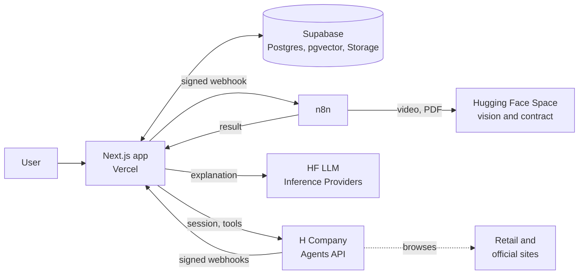

# Chez Soi

> "Mieux, chez soi !" (Better, at home) · Team 2 · Build The Future hackathon (H Company × Hugging Face × Vercel), Eugenia School, 16 to 20 November 2026.
>
> 🇫🇷 [Version française](README.md). The app, the code comments and the detailed docs are in French.

| | |
|---|---|
| **Prototype** | https://chezsoi.vercel.app (a sample home opens without an account) |
| **Repository** | https://github.com/jeanlisek/Chez-Soi |
| **Try it** | [How to test](#how-to-test), 2 minutes without an account |
| **Agent results** | [40 real runs, measured](docs/resultats.md) (in French) |
| **Detailed architecture** | [Miro board, code status on 19 Nov](https://miro.com/app/board/uXjVEMi8KjI=/) (in French) |
| **Public replays** | [Use 1, MAIF](https://agp.eu.hcompany.ai/share/api/v1/trajectories/6737e71f-59a5-4dc5-ab92-20c49a33d469) · [Use 2, IKEA, demo fallback](https://agp.eu.hcompany.ai/share/api/v1/trajectories/dfb8e4d2-8a96-448b-9a87-c5e8b3740cab) |
<!-- Demo video (5 min): add a "| **Demo video** | <link> |" row here once the link exists, and check that it opens in a private window. -->

Chez Soi turns a video of a home, plus the home insurance contract if the user provides it, into a safety plan fitted to the people who live there: break-ins and falls. An H Company computer-use agent then prepares the actions on real websites. The user always commits personally: sign-in, payment, sending, signature.

## The problem

Falls are the leading cause of accidental death after 65. In France in 2024 they caused 20,148 deaths and 174,824 hospital stays among people aged 65 and over, up 18 % and 20.5 % since 2019 [1]. On the burglary side, the French interior ministry's statistics office (SSMSI) recorded about 211,600 home burglaries or attempts in 2025 [2].

Part of this risk can be fixed inside the home: a slippery rug, a door without a three-point lock, shutters left open during a long absence. Three obstacles stand in the way:

- **Knowing what to fix.** A family caregiver does not know which spot is dangerous for this particular person, nor its exact size.
- **Knowing what is mandatory.** The home insurance contract sometimes requires protections or an absence notice, buried in dozens of pages.
- **Taking action.** Finding the right product in the right size, registering for the police holiday watch scheme (Opération tranquillité vacances, OTV), informing the insurer: each step lives on a different website and gets postponed.

Demo persona, fictitious: Marc looks after his mother Jeanne, 79, who lives alone on a ground floor and will be away for 35 days this winter.

## The solution

1. **Profile** of the occupant: functional abilities (mobility, sight, hearing, alertness), never a medical diagnosis, with dated consent.
2. **Contract** (optional): the PDF is read; every clause kept carries its quote and page. A clause without proof in the PDF is rejected.
3. **Walkthrough**: one video per room. The vision service rebuilds the room in 3D, spots risk points and estimates their sizes in centimetres.
4. **Action plan**: each point is checked against sourced, validated rules. Verdict order: contract (clause and page), then law, then recommendation. An LLM writes the explanation; a code guardrail checks it.
5. **H agent**: it runs three tasks on real websites and always stops before any commitment.

| Use | What the agent does | Where it stops |
|---|---|---|
| 1 · General terms | Finds the contract's general terms on the insurer's official website; our code downloads the PDF and checks its reference | Read-only, no sign-in |
| 2 · Countermeasure | Reads the risk point's sizes (`get_mesures`), picks a compatible product, proves compatibility with a quote from the product page, adds it to the cart | `demander_validation`: nothing is ordered without the user's click |
| 3 · Absence | Prepares the OTV registration and the insurer notice from the dates and the contract clauses | Nothing sent, no FranceConnect sign-in |

## Why a computer-use agent

Retail sites, insurers' customer areas and public services offer no open API. Their pages change, and picking the right product means reading the page like a person: dimensions, whether it can be cut to size, compatibility, delivery time. An API, a script or n8n alone cannot cover these journeys. The H agent runs them on the real sites, while our code keeps the decision: it supplies the sizes, checks the evidence and cuts the session if the agent drifts.

## Measured results

40 real runs of the H agent on 18 and 19 November, on IKEA France, Decoweb, maif.fr, acheel.com and service-public.gouv.fr. Nothing bought, nothing sent. Details, method and failure cases: [`docs/resultats.md`](docs/resultats.md) (in French).

| Metric | Value | Runs |
|---|---|---|
| Success rate, all uses | 27.5 % (11 successes) | 40 |
| Use 1 · general terms | 4 out of 4 | 4 |
| Use 3 · OTV and insurer | 4 out of 4 | 4 |
| Use 2 · countermeasure, strict quote check | 3 out of 32 (9.4 %) | 32 |
| Mean run duration | 88.5 s | 39 |
| Same task by hand, team estimate | 360 s (use 1), 240 s (use 2), 900 s (use 3) | 12 |
| Mean cost per run | USD 0.062 | 40 |

Reading use 2: the agent reaches the right product and stops at the right time, but often miscopies the product page ("pour tissus", for fabrics, instead of "pour tapis", for rugs). Our check looks for every quote word for word on the public product page and rejects the product if it is not there. We chose a low, verifiable rate over a cart "approved" on distorted evidence.

## What we use from the Agents API

| Feature | In Chez Soi |
|---|---|
| Frozen custom agents (`name:N`) | `chez-soi-sourcing:1` (use 1), `chez-soi-acheteur:2` (use 2), `chez-soi-demarches:1` (use 3), created through the API from [`agents/definitions/`](agents/definitions/) |
| Custom skill | `verifier-dimension:2`: size and cut-to-size are proven by a quote from the product page ([`agents/skills/verifier_dimension.md`](agents/skills/verifier_dimension.md)) |
| Custom tools | `get_mesures` and `get_contrat` answer with the session's home data; `demander_validation` waits for the user's click |
| Structured output | Flat JSON schemas, re-validated with Zod in the app |
| Signed webhooks | `/api/webhooks/hai` checks the signature, drops duplicates and answers tool calls with no waiting process |
| Steering during a run | Message sent to the live session (`/api/agent/steer`), for example "under €50" |
| Session tracking (`/changes`) | Live tracking screen and circuit breaker on visited pages |
| Session sharing | Public replays of runs 5 and 35 |
| Model | Flash `holo4-35b-a3b`, chosen after a 20-run Flash versus Pro bench |

What the API taught us, in short: no native guard stops a click on "Order" (hence our circuit breaker), `outcome` stays empty, the 3-session quota applies to the whole organisation, and a nested schema is poorly followed. Details in [`docs/resultats.md`](docs/resultats.md#ce-que-lagents-api-nous-a-appris).

## The stack

| Layer | Role | Technology |
|---|---|---|
| See | Metric depth, detection, segmentation, 3D reconstruction | **Hugging Face** Space (FastAPI, L4 GPU): MoGe-2 (MIT), Grounding DINO base (Apache 2.0), SAM 2.1 (Apache 2.0), MapAnything Apache variant (Apache 2.0); revisions pinned in [`services/vision/modeles.py`](services/vision/modeles.py) |
| Read | Insurance contract | pypdf, then `Qwen/Qwen2.5-72B-Instruct` (Qwen licence) through HF Inference Providers; every quote is found in the PDF before it is kept |
| Decide | Rules, knowledge graph, verdict, explanation | Postgres + pgvector (Supabase), `BAAI/bge-m3` embeddings (MIT), TypeScript, Zod; explanation by `openai/gpt-oss-120b` (Apache 2.0) through the **Vercel AI SDK** and HF Inference Providers |
| Act | General terms, countermeasure to cart, absence tasks | **H Company** Agents API (see above) |
| Show | User journey, 3D view, approval, absence mode | Next.js 15 on **Vercel**, Tailwind, three.js |
| Base | Data, storage, authentication, orchestration | Supabase (RLS on all 22 tables, private buckets), n8n |

No model under a non-commercial licence is used.

## Architecture



- **Only the app writes to the database.** n8n drives the Hugging Face Space without any Supabase key; it sends results back to an app route, which checks them and writes server-side.
- **The agent only sees what it asks for.** Its tools use the session's home, never one the agent names, and return only the useful fields.
- **A circuit breaker in code** cancels the session as soon as the agent opens an order, payment, sign-in or non-allow-listed page.

Circuit details: [`docs/architecture.md`](docs/architecture.md) (in French). Full diagram of the layers and the base: [Miro](https://miro.com/app/board/uXjVEMi8KjI=/).

## How to test

**1. Without an account (2 minutes).** Open https://chezsoi.vercel.app, then "Voir d'abord un logement exemple" (see a sample home first). Jeanne's home is fictitious. In order: the action plan, the 3D view, a risk point's detail, the replay of a real H agent run on IKEA France (stopped at the cart, waiting for approval), then absence mode.

**2. With an account (5 minutes).**

1. Sign in with Google or an e-mail link: the home is created and the journey starts at the profile.
2. Fill in the profile, then upload a video of one room (MP4 or MOV, 50 MB max). The Space wakes up when the screen opens; the analysis takes a few minutes.
3. Optional: upload a home insurance contract as a PDF. Kept clauses appear with their page. The same screen can start the agent that finds the general terms on the insurer's site.
4. Open the action plan, confirm a risk point's size, then start the agent. The screen follows the real H session and asks for approval before any commitment. Approving orders nothing.
5. Open absence mode and ask the agent to prepare the steps: it prepares the OTV registration and the insurer notice without signing in, then stops; the only possible answer refuses sending.

The Account screen then lets you edit the profile, add an occupant or re-film a room.

**3. Locally.**

```bash
cd apps/web && npm install && npm run dev
```

```bash
cd services/vision && python3 -m venv .venv && .venv/bin/pip install -r requirements.txt && .venv/bin/uvicorn app:app --reload --port 7860
```

Environment variables are listed in [`.env.example`](.env.example) (names only). Checks: `npm run lint`, `npm run typecheck` and `npm run typecheck:agents` in `apps/web`; `HF_HUB_OFFLINE=1 pytest` in `services/vision`; `python3 scripts/resultats.py` for the agent figures.

## Run cost and business model

**Run cost per assessment (a calculation, not an end-to-end measurement).** Using the agent's measured averages and the public price of the Space's L4 GPU (USD 0.80 per hour [3]), an assessment of 5 rooms, 1 contract, 3 countermeasures and 1 absence costs roughly **USD 0.25 to 0.65**, excluding LLM calls and fixed subscriptions. Calculation and assumptions: [`docs/resultats.md`](docs/resultats.md#coût-de-run-par-diagnostic).

**Business model: not decided yet.** Payers considered by the team: the household or the family caregiver, and in B2B, home insurers and pension funds. No price has been set.

## Status on 19 November

In production:

- sign-in with Google or e-mail link, home creation; Account screen to edit the profile, manage several occupants (the rule protecting the most vulnerable applies) and re-film a room;
- guided capture (filming tips, import of an existing video, review before sending), analysis on the Space (automatic wake-up, retries), risk points and sizes stored, 3D model and annotated image of each room in private storage; a re-filmed room replaces its old points, except those whose size was confirmed;
- risk point screen: photo cropped on the element and a "relief photo" of the filmed surface; on the vision side, an object seen in several frames is counted once;
- action plan computed from the rules, with the graph to recognise elements and an LLM-written explanation checked by code;
- end-to-end contract reading, tested with fictitious special conditions;
- H agent inside the app for all three uses: session creation, tool answers through signed webhooks, on-screen tracking, user approval, circuit breaker. On 19 Nov in production: use 2 end to end on `chez-soi-acheteur:2` (130 s, 9 steps, steering sent, stop at the cart on `demander_validation`), use 1 from the Contract screen, and a first real use 3 run after it was wired (#86).

Known limits:

- use 3: on the first real run after it was wired, the agent returned its answer without calling `demander_validation`; the prompt now reminds it, not yet re-checked by a new run (nothing can be sent: the agent does not sign in and the circuit breaker cuts any sign-in page);
- on a real home, the absence departure date cannot be entered yet (15 Dec by default); only the duration can be set;
- use 2 miscopies some product pages: the quote check detects it and rejects the product;
- the Space sleeps after 30 minutes: the first call waits for it to wake up;
- the vision sizes have been compared with a tape measure on one door only (72.9 cm measured for 71.5 cm actual): no accuracy figure is claimed yet ([`docs/mesures.md`](docs/mesures.md)).

Next steps considered: departure date entry, a session prompt that names the plan's countermeasure, one sub-agent per retail site to compare offers, the MaPrimeAdapt' home adaptation grant and tradespeople quotes.

## What the code guarantees

- **The LLM explains, it does not decide.** The verdict comes from validated rules; the model only outputs the explanation text, checked by a guardrail (no invented figure, no "mandatory" for a recommendation).
- **The agent stops before any commitment**: the `demander_validation` tool and a circuit breaker in code, not just a prompt.
- **The contract PDF never goes to the agent**; it only receives the fields it asks for.
- **Health data**: nothing describing a person goes to the agent or the LLM, only constraints on the object.
- **No secret in the repository**; fictitious demo data only.

## Repository layout

| Folder | Contents |
|---|---|
| `apps/web/` | Next.js app: screens, API routes, plan computation (`lib/plan.ts`), graph (`lib/graphe`), explanation (`lib/llm.ts`), H agent (`lib/agent`) |
| `services/vision/` | FastAPI service of the Space: video pipeline (`/analyse`) and contract reading (`/contrat`) |
| `agents/` | Custom agent definitions, `verifier_dimension` skill, tools, recorded real runs (`bench/runs/`) |
| `supabase/` | Migrations 0001 to 0010, 24 sources and 12 rules, graph, SQL tests |
| `n8n/` | Exported workflows: video analysis, contract reading, Space wake-up, regulatory watch |
| `docs/` | [Agent results](docs/resultats.md), [architecture](docs/architecture.md), [vision measurements](docs/mesures.md), [rules](docs/regles.md) |
| `scripts/` | n8n sync, agent results recomputation |

## Team

Jean-Li Sek (CEO), Briac Turquety (CTO, CDO), Aurélie Périchon (CAIO), Bastian Bellard (CAO), Hoang-Kim Luong (CPO).

## Sources

[1] Santé publique France, "Hospitalisations et mortalité en lien avec une chute chez les personnes de 65 ans et plus en France. Données 2015-2024", national bulletin, 12 March 2026, updated 16 March 2026. Primary source. [Online]. Available: https://www.santepubliquefrance.fr/traumatismes/chute/bulletin-national/hospitalisations-et-mortalite-en-lien-avec-une-chute-chez-les-personnes-de-65-ans-et-plus-en-france

[2] SSMSI, statistical report "Insécurité et délinquance en 2025", cited by DegroupTest, "Bonne nouvelle : les cambriolages ont reculé en 2025, mais les grandes villes restent plus exposées". Secondary source. [Online]. Available: https://www.degrouptest.com/actualite/cambriolages-recul-2025-ssmsi-disparites-regionales

[3] Hugging Face, "GPU Spaces", Hub documentation, hardware pricing (1x Nvidia L4: USD 0.80 per hour), accessed 19 November 2026. [Online]. Available: https://huggingface.co/docs/hub/main/spaces-gpus
