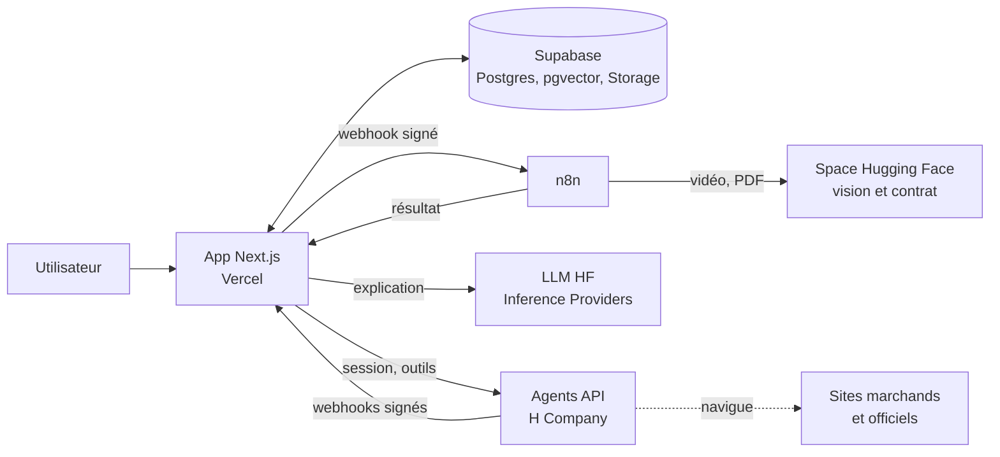

# Chez Soi

> « Parce qu'on est mieux, chez soi. » · Team 2 · Hackathon Build The Future (H Company × Hugging Face × Vercel), Eugenia School, 16 au 20 novembre 2026.
>
> 🇬🇧 [English version](README.en.md)

| | |
|---|---|
| **Prototype** | https://chezsoi.vercel.app (un logement exemple s'ouvre sans compte) |
| **Dépôt** | https://github.com/jeanlisek/Chez-Soi |
| **Tester** | [Comment tester](#comment-tester), en 2 minutes sans compte |
| **Résultats de l'agent** | [40 runs réels mesurés](docs/resultats.md) |
| **Architecture détaillée** | [Schéma Miro, état du code au 19/11](https://miro.com/app/board/uXjVEMi8KjI=/) |
| **Maquettes** | [Figma : parcours utilisateurs et écrans](https://www.figma.com/design/Qrx8XsJiiFWFeY98FX4dJ9/Chez-soi---Parcours-utilisateurs-et-%C3%A9crans?node-id=0-1) |
| **Replays publics** | [Usage 1, MAIF](https://agp.eu.hcompany.ai/share/api/v1/trajectories/6737e71f-59a5-4dc5-ab92-20c49a33d469) · [Usage 2, IKEA, plan B de la démo](https://agp.eu.hcompany.ai/share/api/v1/trajectories/dfb8e4d2-8a96-448b-9a87-c5e8b3740cab) |
<!-- Vidéo démo (5 min) : ajouter ici une ligne « | **Vidéo démo** | <lien> | » dès que le lien existe, et vérifier qu'il s'ouvre en navigation privée. -->

Chez Soi transforme une vidéo du logement, et le contrat d'assurance habitation si l'utilisateur le fournit, en plan de sécurité adapté aux occupants : intrusion et chutes. Un agent computer-use H Company prépare ensuite les actions sur les vrais sites. L'utilisateur s'engage toujours lui-même : connexion, paiement, envoi, signature.

## Le problème

Les chutes sont la première cause de décès accidentel après 65 ans. En 2024 en France, elles ont causé 20 148 décès et 174 824 hospitalisations chez les 65 ans et plus, en hausse de 18 % et de 20,5 % depuis 2019 [1]. Côté intrusion, le SSMSI a recensé environ 211 600 cambriolages ou tentatives dans des logements en 2025 [2].

Une partie de ces risques se règle dans le logement : un tapis qui glisse, une porte sans serrure trois points, des volets laissés ouverts pendant une longue absence. Trois obstacles empêchent de le faire :

- **Savoir quoi corriger.** L'aidant ne sait pas quel point du logement est dangereux pour cet occupant précis, ni avec quelle cote.
- **Savoir ce qui est obligatoire.** Le contrat d'assurance habitation impose parfois des protections ou une déclaration d'absence, enfouies dans des dizaines de pages.
- **Passer à l'action.** Trouver le bon produit aux bonnes dimensions, préparer l'Opération tranquillité vacances (OTV), prévenir l'assureur : autant de démarches, chacune sur un site différent, qu'on remet à plus tard.

Persona de démo, fictif : Marc aide sa mère Jeanne, 79 ans, qui vit seule en rez-de-chaussée et s'absente 35 jours cet hiver.

## La solution

1. **Profil** de l'occupant : capacités fonctionnelles (déplacement, vue, audition, vigilance), jamais de diagnostic médical, avec un consentement daté.
2. **Contrat** (facultatif) : le PDF est lu ; chaque clause retenue garde sa citation et sa page. Une clause sans preuve dans le PDF est rejetée.
3. **Visite** : une vidéo par pièce. Le service vision reconstruit la pièce en 3D, repère les points de risque et estime leurs cotes en centimètres.
4. **Plan d'action** : chaque point est confronté à des règles sourcées et validées. Ordre du verdict : contrat (clause et page), puis loi, puis recommandation. Un LLM rédige l'explication ; un garde-fou en code la relit.
5. **Agent H** : il exécute trois démarches sur les vrais sites et s'arrête toujours avant l'engagement.

| Usage | Ce que fait l'agent | Où il s'arrête |
|---|---|---|
| 1 · Conditions générales | Retrouve sur le site officiel de l'assureur les conditions générales du contrat ; le code télécharge le PDF et vérifie la référence | Lecture seule, aucune connexion |
| 2 · Contre-mesure | Lit les cotes du point de risque (`get_mesures`), choisit un produit compatible, prouve la compatibilité par une citation de la fiche, le met au panier | `demander_validation` : rien n'est commandé sans le clic de l'utilisateur |
| 3 · Absence | Prépare l'OTV et l'information de l'assureur à partir des dates et des clauses du contrat | Aucun envoi, aucune connexion FranceConnect |

## Pourquoi un agent computer-use

Les sites marchands, les espaces des assureurs et les démarches publiques n'offrent pas d'API ouverte. Leurs pages changent, et choisir le bon produit demande de lire la fiche comme un humain : dimensions, possibilité de découpe, compatibilité, délai. Une API, un script ou n8n seul ne couvrent pas ces parcours. L'agent H les fait sur les sites réels, et notre code garde la décision : il fournit les cotes, vérifie les preuves et coupe la session en cas de dérive.

## Résultats mesurés

40 runs réels de l'agent H, les 18 et 19 novembre, sur IKEA France, Decoweb, maif.fr, acheel.com et service-public.gouv.fr. Aucun achat, aucun envoi. Détail, méthode et cas d'échec : [`docs/resultats.md`](docs/resultats.md).

| Mesure | Valeur | Runs |
|---|---|---|
| Taux de réussite, tous usages | 27,5 % (11 succès) | 40 |
| Usage 1 · conditions générales | 4 sur 4 | 4 |
| Usage 3 · OTV et assureur | 4 sur 4 | 4 |
| Usage 2 · contre-mesure, contrôle strict des citations | 3 sur 32 (9,4 %) | 32 |
| Durée moyenne d'un run | 88,5 s | 39 |
| Même tâche à la main, estimation de l'équipe | 360 s (usage 1), 240 s (usage 2), 900 s (usage 3) | 12 |
| Coût moyen d'un run | 0,062 USD | 40 |

Lecture de l'usage 2 : l'agent atteint le bon produit et s'arrête au bon moment, mais recopie souvent mal la fiche (« pour tissus » au lieu de « pour tapis »). Notre contrôle cherche chaque citation mot pour mot sur la fiche publique et refuse le produit si elle n'y est pas. Nous avons préféré un taux bas et vérifiable à un panier « validé » sur une preuve déformée.

## Ce que nous utilisons de l'Agents API

| Fonctionnalité | Dans Chez Soi |
|---|---|
| Agents maison figés (`nom:N`) | `chez-soi-sourcing:1` (usage 1), `chez-soi-acheteur:2` (usage 2), `chez-soi-demarches:1` (usage 3), créés par l'API depuis [`agents/definitions/`](agents/definitions/) |
| Skill maison | `verifier-dimension:2` : la dimension et la découpe se prouvent par une citation de la fiche ([`agents/skills/verifier_dimension.md`](agents/skills/verifier_dimension.md)) |
| Custom tools | `get_mesures` et `get_contrat` répondent avec les données du logement de la session ; `demander_validation` attend le clic de l'utilisateur |
| Sortie structurée | Schémas JSON plats, revalidés par Zod côté application |
| Webhooks signés | `/api/webhooks/hai` vérifie la signature, ignore les doublons et répond aux outils sans processus qui attend |
| Pilotage en cours de run | Consigne envoyée pendant la session (`/api/agent/steer`), par exemple « moins de 50 € » |
| Suivi de session (`/changes`) | Écran de suivi en direct et coupe-circuit sur les pages vues |
| Partage de session | Replays publics des runs 5 et 35 |
| Modèle | Flash `holo4-35b-a3b`, retenu après un banc Flash contre Pro de 20 runs |

Ce que l'API nous a appris, en bref : aucun garde-fou natif n'empêche un clic sur « Commander » (d'où notre coupe-circuit), `outcome` reste vide, le quota de 3 sessions vaut pour toute l'organisation, et un schéma imbriqué est mal suivi. Détail dans [`docs/resultats.md`](docs/resultats.md#ce-que-lagents-api-nous-a-appris).

## La stack

| Couche | Rôle | Technologie |
|---|---|---|
| Voir | Profondeur métrique, détection, contours, reconstruction 3D | Space **Hugging Face** (FastAPI, GPU L4) : MoGe-2 (MIT), Grounding DINO base (Apache 2.0), SAM 2.1 (Apache 2.0), MapAnything variante Apache (Apache 2.0) ; révisions figées dans [`services/vision/modeles.py`](services/vision/modeles.py) |
| Lire | Contrat d'assurance | pypdf, puis `Qwen/Qwen2.5-72B-Instruct` (licence Qwen) par HF Inference Providers ; chaque citation est retrouvée dans le PDF avant d'être gardée |
| Décider | Règles, graphe de connaissances, verdict, explication | Postgres + pgvector (Supabase), embeddings `BAAI/bge-m3` (MIT), TypeScript, Zod ; explication par `openai/gpt-oss-120b` (Apache 2.0) via **Vercel AI SDK** et HF Inference Providers |
| Agir | Conditions générales, contre-mesure au panier, démarches d'absence | **H Company** Agents API (voir plus haut) |
| Montrer | Parcours, vue 3D, validation, mode absence | Next.js 15 sur **Vercel**, Tailwind, three.js |
| Socle | Données, stockage, authentification, orchestration | Supabase (RLS sur les 22 tables, buckets privés), n8n |

Aucun modèle sous licence non commerciale n'est utilisé.

## L'architecture



- **C'est l'application qui écrit en base.** n8n orchestre le Space Hugging Face sans aucune clé Supabase ; il renvoie les résultats à une route de l'app, qui vérifie puis écrit côté serveur.
- **L'agent ne voit que ce qu'il demande.** Ses outils prennent le logement de la session, jamais celui que l'agent donne, et ne renvoient que les champs utiles.
- **Un coupe-circuit dans le code** annule la session dès que l'agent ouvre une page de commande, de paiement, de connexion ou hors liste blanche.

Détail des circuits : [`docs/architecture.md`](docs/architecture.md). Schéma complet des couches et du socle : [Miro](https://miro.com/app/board/uXjVEMi8KjI=/).

## Comment tester

**1. Sans compte (2 minutes).** Ouvrir https://chezsoi.vercel.app puis « Voir d'abord un logement exemple ». Le logement de Jeanne est fictif. À voir dans l'ordre : le plan d'action, la vue 3D, la fiche d'un point de risque, le replay d'un vrai run de l'agent H sur IKEA France (arrêté au panier, en attente de validation), puis le mode absence.

**2. Avec un compte (5 minutes).**

1. Se connecter par Google ou par lien e-mail : le logement est créé, le parcours commence au profil.
2. Remplir le profil, puis déposer la vidéo d'une pièce (MP4 ou MOV, 50 Mo au plus). Le Space se réveille à l'ouverture de l'écran ; l'analyse prend quelques minutes.
3. Facultatif : déposer un contrat d'assurance habitation en PDF. Les clauses retenues apparaissent avec leur page. Le même écran peut lancer l'agent qui retrouve les conditions générales sur le site de l'assureur.
4. Ouvrir le plan d'action, confirmer la cote d'un point, puis lancer l'agent. L'écran suit la vraie session H et demande la validation avant tout engagement. Approuver ne commande rien.
5. Ouvrir le mode absence et demander à l'agent de préparer les démarches : il prépare l'OTV et l'information de l'assureur sans se connecter, puis s'arrête ; la seule réponse possible refuse l'envoi.

L'écran Compte permet ensuite de modifier le profil, d'ajouter un occupant ou de refilmer une pièce.

**3. En local.**

```bash
cd apps/web && npm install && npm run dev
```

```bash
cd services/vision && python3 -m venv .venv && .venv/bin/pip install -r requirements.txt && .venv/bin/uvicorn app:app --reload --port 7860
```

Les variables d'environnement sont listées dans [`.env.example`](.env.example) (noms uniquement). Vérifications : `npm run lint`, `npm run typecheck` et `npm run typecheck:agents` dans `apps/web` ; `HF_HUB_OFFLINE=1 pytest` dans `services/vision` ; `python3 scripts/resultats.py` pour les chiffres de l'agent.

## Coût de run et modèle économique

**Coût de run par diagnostic (calcul, pas une mesure de bout en bout).** Avec les moyennes mesurées de l'agent et le tarif public du GPU L4 du Space (0,80 USD par heure [3]), un diagnostic de 5 pièces, 1 contrat, 3 contre-mesures et 1 absence coûte de l'ordre de **0,25 à 0,65 USD**, hors appels LLM et abonnements fixes. Calcul et hypothèses : [`docs/resultats.md`](docs/resultats.md#coût-de-run-par-diagnostic).

**Modèle économique : non tranché.** Payeurs envisagés par l'équipe : le particulier ou l'aidant, et en B2B les assureurs habitation et les caisses de retraite. Aucun prix n'est fixé à ce stade.

## État au 19 novembre

En production :

- connexion par Google ou lien e-mail, création du logement ; écran Compte pour modifier le profil, gérer plusieurs occupants (la règle du plus vulnérable s'applique) et refilmer une pièce ;
- capture guidée (conseils pour bien filmer, import d'une vidéo déjà tournée, relecture avant l'envoi), analyse sur le Space (réveil automatique, nouveaux essais), points de risque et cotes en base, modèle 3D et image annotée de chaque pièce dans le stockage privé ; une pièce refilmée remplace ses anciens points, sauf ceux dont la cote a été confirmée ;
- écran du point : photo cadrée sur l'élément et « photo en relief » de la surface filmée ; côté vision, un objet revu dans plusieurs images n'est compté qu'une fois ;
- profil en trois étapes, accord des habitants retirable à tout moment (capacités effacées sans accord) ; détection étendue aux serrures, escaliers, éclairages et détecteurs de fumée, repérés sans cote ;
- plan d'action calculé sur les règles, avec le graphe pour reconnaître les éléments et une explication rédigée par un LLM puis contrôlée par du code ;
- lecture du contrat de bout en bout, testée avec des conditions particulières fictives ;
- agent H dans l'application pour les trois usages : création de la session, réponses aux outils par webhook signé, suivi à l'écran, validation par l'utilisateur, coupe-circuit. Le 19/11 en production : usage 2 de bout en bout sur `chez-soi-acheteur:2` (130 s, 9 étapes, pilotage envoyé, arrêt au panier sur `demander_validation`), usage 1 depuis l'écran Contrat, et un premier run réel de l'usage 3 après son branchement (#86).

Limites connues :

- usage 3 : au premier run réel après son branchement, l'agent a rendu sa réponse sans passer par `demander_validation` ; la consigne le rappelle désormais, pas encore revérifié par un nouveau run (rien ne peut partir : l'agent ne se connecte pas et le coupe-circuit coupe toute page de connexion) ;
- sur un vrai logement, la date de départ de l'absence n'est pas encore saisissable (15/12 par défaut) ; seule la durée se règle ;
- l'usage 2 recopie mal certaines fiches produit : le contrôle des citations le détecte et refuse le produit ;
- le Space se met en veille après 30 minutes : le premier appel attend son réveil ;
- les cotes du service vision ne sont comparées au mètre ruban que sur une porte (72,9 cm mesurés pour 71,5 cm réels) : pas encore de précision annoncée ([`docs/mesures.md`](docs/mesures.md)).

Suite envisagée : la saisie de la date de départ, une consigne de session qui nomme la contre-mesure, un sous-agent par site marchand pour comparer les offres, la demande d'aide MaPrimeAdapt' et les devis d'artisans.

## Ce que le code garantit

- **Le LLM explique, il ne décide pas.** Le verdict vient des règles validées ; la sortie du modèle ne contient que le texte de l'explication, relu par un garde-fou (aucun chiffre inventé, pas de « obligatoire » pour une recommandation).
- **L'agent s'arrête avant tout engagement** : l'outil `demander_validation` et un coupe-circuit dans le code, pas seulement une consigne.
- **Le PDF du contrat ne va jamais à l'agent** ; il ne reçoit que les champs demandés.
- **Données de santé** : rien de ce qui décrit une personne ne part chez l'agent ni chez le LLM, seulement les contraintes sur l'objet.
- **Aucun secret dans le dépôt** ; données de démo fictives uniquement.

## Arborescence

| Dossier | Contenu |
|---|---|
| `apps/web/` | Application Next.js : écrans, routes API, calcul du plan (`lib/plan.ts`), graphe (`lib/graphe`), explication (`lib/llm.ts`), agent H (`lib/agent`) |
| `services/vision/` | Service FastAPI du Space : pipeline vidéo (`/analyse`) et lecture du contrat (`/contrat`) |
| `agents/` | Définitions des agents maison, skill `verifier_dimension`, outils, runs réels enregistrés (`bench/runs/`) |
| `supabase/` | Migrations 0001 à 0012, 24 sources et 13 règles, graphe avec 3 textes de loi, tests SQL |
| `n8n/` | Workflows exportés : analyse vidéo, lecture du contrat, réveil du Space, veille réglementaire |
| `docs/` | [Résultats de l'agent](docs/resultats.md), [architecture](docs/architecture.md), [mesures de la vision](docs/mesures.md), [règles](docs/regles.md) |
| `scripts/` | Synchronisation n8n, recalcul des résultats de l'agent |

Le détail par partie est dans [`supabase/README.md`](supabase/README.md), [`n8n/README.md`](n8n/README.md), [`agents/README.md`](agents/README.md) et [`services/vision/README.md`](services/vision/README.md). Contexte complet et règles de travail de l'équipe : [`CLAUDE.md`](CLAUDE.md).

## Équipe

Jean-Li Sek (CEO), Briac Turquety (CTO, CDO), Aurélie Périchon (CAIO), Bastian Bellard (CAO), Hoang-Kim Luong (CPO).

## Sources

[1] Santé publique France, « Hospitalisations et mortalité en lien avec une chute chez les personnes de 65 ans et plus en France. Données 2015-2024 », bulletin national, 12 mars 2026, mis à jour le 16 mars 2026. Source primaire. [En ligne]. Disponible : https://www.santepubliquefrance.fr/traumatismes/chute/bulletin-national/hospitalisations-et-mortalite-en-lien-avec-une-chute-chez-les-personnes-de-65-ans-et-plus-en-france

[2] SSMSI, bilan statistique « Insécurité et délinquance en 2025 », cité par DegroupTest, « Bonne nouvelle : les cambriolages ont reculé en 2025, mais les grandes villes restent plus exposées ». Source secondaire. [En ligne]. Disponible : https://www.degrouptest.com/actualite/cambriolages-recul-2025-ssmsi-disparites-regionales

[3] Hugging Face, « GPU Spaces », documentation du Hub, tarifs du matériel (1x Nvidia L4 : 0,80 USD par heure), consulté le 19/11/2026. [En ligne]. Disponible : https://huggingface.co/docs/hub/main/spaces-gpus
