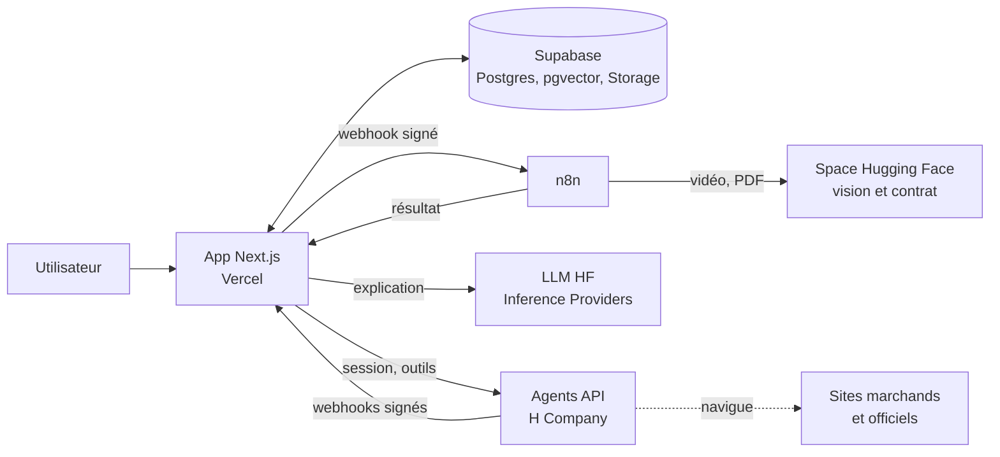

# Chez Soi

> « Mieux, chez soi ! » · Team 2 · Hackathon Build The Future (H Company × Hugging Face × Vercel), Eugenia School, 16 au 20 novembre 2026.

| | |
|---|---|
| **Prototype** | https://chezsoi.vercel.app (logement exemple ouvert sans compte) |
| **Dépôt** | https://github.com/jeanlisek/Chez-Soi |
| **Tester** | [Comment tester](#comment-tester), en 5 minutes |

Chez Soi transforme une vidéo du logement, plus le contrat d'assurance habitation si l'utilisateur le fournit, en plan de sécurité adapté aux occupants (intrusion et chutes). Un agent computer-use H Company prépare ensuite les actions. L'utilisateur s'engage toujours lui-même : connexion, paiement, envoi, signature.

## Le problème

Les chutes sont la première cause de décès accidentel après 65 ans. En 2024 en France, elles ont causé 20 148 décès et 174 824 hospitalisations chez les 65 ans et plus, en hausse de 18 % et de 20,5 % depuis 2019 [1]. Côté intrusion, le SSMSI a recensé environ 211 600 cambriolages ou tentatives dans des logements en 2025 [2].

Une partie de ces risques se règle dans le logement : un tapis qui glisse, une porte sans serrure trois points, des volets laissés ouverts pendant une longue absence. Trois obstacles empêchent de le faire :

- **Savoir quoi corriger.** L'aidant ne sait pas quel point du logement est dangereux pour cet occupant précis, ni avec quelle cote.
- **Savoir ce qui est obligatoire.** Le contrat d'assurance habitation impose parfois des protections ou une déclaration d'absence, enfouies dans des dizaines de pages.
- **Passer à l'action.** Trouver le bon produit aux bonnes dimensions, préparer l'Opération tranquillité vacances, prévenir l'assureur : autant de démarches qu'on remet à plus tard.

Persona de démo, fictif : Marc aide sa mère Jeanne, 79 ans, qui vit seule en rez-de-chaussée et s'absente 35 jours cet hiver.

## La solution

1. **Profil** des occupants (plusieurs par logement) : capacités fonctionnelles (déplacement, vue, audition, vigilance), jamais de diagnostic, avec un accord daté et retirable. Sans accord, les capacités sont effacées.
2. **Contrat** (facultatif) : le PDF est lu, chaque clause retenue garde sa citation et sa page. Une clause sans preuve dans le PDF est rejetée.
3. **Visite** : une vidéo par pièce, filmée de l'intérieur. Le service vision reconstruit la pièce en 3D, repère les points de risque (tapis, portes, fenêtres, serrure, escalier, éclairage, détecteur de fumée) et estime les cotes des tapis, portes et fenêtres. Un second modèle d'images revoit chaque point pour écarter les confusions (une pomme de douche n'est pas un détecteur de fumée). L'utilisateur confirme les cotes avant toute action, et peut signaler une erreur de détection.
4. **Plan d'action** : chaque point est confronté aux règles validées. Ordre du verdict : contrat (clause et page), puis loi, puis recommandation. Un LLM rédige l'explication, un garde-fou en code la relit.
5. **Agent** : l'agent H cherche un produit du bon type et aux bonnes dimensions, le met au panier et s'arrête. Rien ne part sans le clic de l'utilisateur.
6. **Absence** : au-delà du seuil d'inoccupation du contrat, l'app prépare l'information de l'assureur et l'Opération tranquillité vacances, sans envoi.

## La stack

| Couche | Rôle | Technologie |
|---|---|---|
| Voir | Reconstruction 3D, cotes, détection ; lecture du contrat | Space GPU **Hugging Face** (FastAPI) : MoGe-2 (cotes), Grounding DINO et SAM 2.1 (détection, contours), SigLIP (vérification des points), MapAnything (3D) ; Docling (contrat). Embeddings `BAAI/bge-m3` et LLM par HF Inference Providers. Tous les modèles sont figés sur une révision, sous licence MIT ou Apache 2.0 |
| Décider | Règles, graphe de connaissances, verdict, explication | Postgres + pgvector (Supabase), TypeScript, **Vercel AI SDK**, Zod |
| Agir | Conditions générales de l'assureur, achat d'objets, démarches | **H Company** Agents API : agents maison, custom tools, skill `verifier-dimension`, webhooks signés |
| Montrer | Parcours, vue 3D, validation, mode absence | Next.js 15 sur **Vercel**, Tailwind, three.js |
| Socle | Données, stockage, authentification, orchestration | Supabase (RLS sur les 22 tables, hébergé à Paris), n8n |

## L'architecture



- **C'est l'application qui écrit en base.** n8n orchestre le Space Hugging Face sans aucune clé Supabase ; il renvoie les résultats à une route de l'app, qui vérifie puis écrit côté serveur.
- **L'agent ne voit que ce qu'il demande.** Ses outils (`get_mesures`, `get_contrat`) prennent le logement de la session, jamais celui que l'agent donne, et ne renvoient que les champs utiles. `demander_validation` n'est répondu qu'après le clic de l'utilisateur.
- **Un coupe-circuit dans le code** annule la session dès que l'agent ouvre une page de commande, de paiement, de connexion ou hors liste blanche.

Détail des circuits : [`docs/architecture.md`](docs/architecture.md). Contexte complet et règles de travail : [`CLAUDE.md`](CLAUDE.md).

Démo : [fiche de déroulé](docs/deroule-demo.md) et [protocole du replay depuis l’app](docs/protocole-replay-app.md).

## Comment tester

**1. Sans compte (2 minutes).** Ouvrir https://chezsoi.vercel.app puis « Voir d'abord un logement exemple ». Le logement de Jeanne est fictif : plan d'action, vue 3D, fiche d'un point de risque, mode absence, et le replay d'un vrai run de l'agent H sur IKEA France, arrêté au panier.

**2. Avec un compte (5 minutes).**

1. Se connecter par Google ou par lien e-mail : le logement est créé, le parcours commence au profil.
2. Remplir le profil, puis déposer une vidéo d'une pièce (MP4 ou MOV, 50 Mo au plus). Le Space se réveille à l'ouverture de l'écran ; l'analyse prend quelques minutes.
3. Facultatif : déposer un contrat d'assurance habitation en PDF. Les clauses retenues apparaissent avec leur page. Le même écran peut lancer l'agent qui retrouve les conditions générales sur le site de l'assureur.
4. Ouvrir le plan d'action, confirmer la cote d'un point, puis lancer l'agent. L'écran suit la vraie session H et demande la validation avant tout engagement. Approuver ne commande rien.

**3. En local.**

```bash
cd apps/web && npm install && npm run dev
```

```bash
cd services/vision && python3 -m venv .venv && .venv/bin/pip install -r requirements.txt && .venv/bin/uvicorn app:app --reload --port 7860
```

Les variables d'environnement sont listées dans [`.env.example`](.env.example) (noms uniquement). Vérifications : `npm run lint`, `npm run typecheck` et `npm run typecheck:agents` dans `apps/web` ; `HF_HUB_OFFLINE=1 pytest` dans `services/vision`.

## État au 19 novembre

En production sur https://chezsoi.vercel.app :

- connexion par Google ou lien e-mail, logement, profil complet de plusieurs occupants, accord retirable, déménagement (les vidéos et analyses de l'ancien logement sont effacées) ;
- dépôt d'une vidéo par pièce, analyse sur le Space GPU (réveil automatique, nouveaux essais), points de risque et cotes en base, photo annotée et modèle 3D de chaque pièce ;
- plan d'action calculé sur 13 règles en vigueur, chacune sourcée (24 sources : Légifrance, Santé publique France, HAS, AFNOR, Service-Public…) et validée par une personne ; le graphe de connaissances (50 nœuds, 35 arêtes) relie clauses, articles de loi, règles, éléments et contre-mesures ;
- lecture du contrat de bout en bout, testée avec des conditions particulières fictives ;
- les trois usages de l'agent H, lancés depuis l'app avec de vrais runs le 19/11 :
  - **usage 1**, conditions générales : l'agent retrouve le PDF sur le site de l'assureur ; le code le télécharge et vérifie lui-même la référence ;
  - **usage 2**, achat d'objets : l'agent trouve un antidérapant pour tapis aux bonnes dimensions sur IKEA France, le met au panier, puis s'arrête sur `demander_validation` ; l'utilisateur a refusé, rien n'a été commandé ;
  - **usage 3**, absence : à partir des dates saisies, l'agent prépare le récapitulatif de l'Opération tranquillité vacances et de l'information de l'assureur ; rien n'est envoyé, l'utilisateur se connecte lui-même ;
- chaque run est suivi à l'écran, pilotable en cours de route (« moins de 50 € »), arrêtable, et tracé dans `runs_agent` (étapes, pages vues, coût : 0,03 à 0,08 $ par session).

Limites connues :

- la détection peut encore se tromper : l'utilisateur confirme les cotes et peut retirer un point ;
- seul l'intérieur du logement est analysé ;
- le Space se met en veille après 30 minutes : le premier appel attend son réveil ;
- l'usage 3 tourne dans le navigateur cloud de H, pas dans celui de l'utilisateur ; « voir le navigateur en direct » n'existe que sur le logement exemple (replay).

Pas commencé : réalité augmentée, export Minecraft.

## Ce que le code garantit

- **Le LLM explique, il ne décide pas.** Le verdict vient des règles validées ; la sortie du modèle ne contient que le texte de l'explication, relu par un garde-fou (aucun chiffre inventé, pas de « obligatoire » pour une recommandation).
- **L'agent s'arrête avant tout engagement** : l'outil `demander_validation` et un coupe-circuit dans le code, pas seulement une consigne.
- **Le code relit le travail de l'agent** : dimensions, nom du produit, citation de la fiche. Lors du run du 19/11 au soir, il a relevé une citation qui n'était pas mot pour mot celle de la fiche (« tissus » au lieu de « tapis ») et a marqué le produit à refuser.
- **Le PDF du contrat ne va jamais à l'agent** ; il ne reçoit que les champs demandés.
- **Données de santé** : rien de ce qui décrit une personne ne part chez l'agent ni chez le LLM, seulement les contraintes sur l'objet.
- **Aucun secret dans le dépôt** ; données de démo fictives uniquement.

## Arborescence

| Dossier | Contenu |
|---|---|
| `apps/web/` | Application Next.js : écrans, routes API, calcul du plan (`lib/plan.ts`), graphe (`lib/graphe`), explication (`lib/llm.ts`), agent H (`lib/agent`) |
| `services/vision/` | Service FastAPI du Space : pipeline vidéo (`/analyse`) et lecture du contrat (`/contrat`) |
| `agents/` | Définitions des agents maison, prompts, déclarations d'outils, skill `verifier_dimension`, runs réels enregistrés |
| `supabase/` | Migrations 0001 à 0012, seed des règles et du graphe, tests SQL |
| `n8n/` | Workflows exportés : analyse vidéo, lecture du contrat, réveil du Space, veille réglementaire |
| `docs/` | Architecture, mesures, règles |

Le détail par partie est dans `supabase/README.md`, `n8n/README.md`, `agents/README.md` et `services/vision/README.md`.

## Équipe

Jean-Li Sek (CEO), Briac Turquety (CTO, CDO), Aurélie Périchon (CAIO), Bastian Bellard (CAO), Hoang-Kim Luong (CPO).

## Sources

[1] Santé publique France, « Hospitalisations et mortalité en lien avec une chute chez les personnes de 65 ans et plus en France. Données 2015-2024 », bulletin national, 12 mars 2026, mis à jour le 16 mars 2026. [En ligne]. Disponible : https://www.santepubliquefrance.fr/traumatismes/chute/bulletin-national/hospitalisations-et-mortalite-en-lien-avec-une-chute-chez-les-personnes-de-65-ans-et-plus-en-france

[2] SSMSI, « Insécurité et délinquance en 2025 : bilan statistique et atlas départemental », Interstats, ministère de l'Intérieur, 9 juillet 2026. [En ligne]. Disponible : https://www.interieur.gouv.fr/Interstats/Actualites/Insecurite-et-delinquance-en-2025-bilan-statistique-et-atlas-departemental. Chiffre de 211 600 repris par DegroupTest : https://www.degrouptest.com/actualite/cambriolages-recul-2025-ssmsi-disparites-regionales

## In English

Chez Soi turns a video of a home (and, optionally, the home insurance contract) into a safety plan fitted to the people who live there, against falls and burglary. A Hugging Face GPU Space reconstructs each room in 3D, finds risk points and measures them; a second vision model double-checks every point. A rules engine on Postgres + pgvector decides the verdict (contract clause with page, then law, then recommendation); an LLM only writes the explanation. H Company agents then do the legwork on real websites (insurer's terms, a product with the right dimensions in the cart, holiday-watch paperwork) and always stop before paying, sending or signing: the stop is enforced in code through the `demander_validation` tool and a circuit breaker. Try it without an account at https://chezsoi.vercel.app (example home, fictitious persona).
